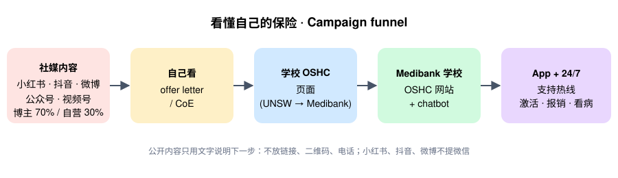

# Medibank China Social Media Agent

**An AI agent that helps Medibank build a direct relationship with Chinese international
students on Chinese social media (小红书, 微信公众号, 微信视频号, 抖音, 微博), reaching them
before education agents take over, so they know Medibank, realise student insurance
matters, and want to learn about it themselves.**

Works in **Claude** (Claude.ai Projects, Claude Code) and **OpenAI Codex**, or from the
command line through the Claude API. Built by UNSW CDEV3000 MB Group 6 (T3 2026) as the
project deliverable for Medibank.

> ⚠️ The compliance rules in this repo are a student research summary, not legal advice.
> Medibank Legal & Compliance and PRC counsel should review `references/compliance.md`
> before the agent is used for real campaigns. Anything marked `[VERIFY]` needs checking.

中文使用说明：[使用说明.md](使用说明.md)

---

## The problem it solves

Most Chinese international students let an education agent (留学中介) handle everything,
including their OSHC. The agent picks the insurer and arranges the cover, so Medibank never
has direct contact with the student, and the student never thinks about insurance until
they need it in Australia.

Before they leave, these students get their information from 小红书, 公众号, 抖音, 视频号
and 微博. That is where Medibank can meet them first. But these are mainland platforms and
Medibank has no insurance licence in China, so it can build awareness there, never sell.
The agent is built around one rule:

> **On Chinese platforms, Medibank informs and helps. It does not sell.**

## What it aims for

This agent is the awareness step. A later chatbot on the Medibank university OSHC site
handles detailed policy questions.

The agent's three goals, in order:

1. **Know Medibank**: students meet Medibank on the platforms they already use, before departure.
2. **Care about OSHC**: they realise student insurance affects them (seeing a GP, emergencies, claims).
3. **Learn for yourself**: they want to understand their own cover instead of leaving it all to the agent.

Content sparks the question; it does not try to answer every policy detail. Detailed
questions are pointed, in words, to the university OSHC page and the chatbot.



```
Post or video (creator 70% / owned 30%) on 小红书 · 公众号 · 视频号 · 抖音 · 微博
  →  "insurance matters, I should check mine"   (e.g. find the OSHC line in your offer letter)
  →  university OSHC page (e.g. UNSW → Medibank's UNSW OSHC site)
  →  student chatbot on that site  →  Medibank app and 24/7 support line
```

Content never contains prices, links, QR codes or "DM me to buy". It names the next step
in words.

## What the agent does

| Skill | Ask it… | You get |
|-------|---------|---------|
| `medibank-cn-social` (router) | Anything vague: "下个月社媒怎么做" | Picks the platform and the sub-skill, runs multi-step work |
| `cn-content-writer` | "写一篇小红书：第一次在悉尼看 GP" / "写一篇公众号长文" / "写一个抖音 60 秒脚本" | Post, article or script in the platform's format, titles, tags, image/shot plan, compliance verdict, facts to confirm |
| `cn-repurpose` | "把这篇公众号改成另外四个平台" | One idea, five native versions, each scanned at its own platform level |
| `cn-content-planner` | "2027 T1 开学季 4 周计划" | Cross-platform calendar (platform, owned/creator, persona, pillar, format, KPI, risk) checked by `calendar_builder.py` |
| `cn-kol-manager` | "找 UNSW 新生相关的博主" / "给这批博主打分" / "写星图 brief" / "审这篇博主稿" | Search plan per marketplace, scored shortlist, vetting, brief, draft review with change requests |
| `cn-compliance-review` | Paste any draft | 🟢 / 🟡 / 🔴 verdict, each problem line with rule ID and fixed wording |
| `cn-community-manager` | "这些评论怎么回" / "有人在微博骂我们" | Replies by platform tone, escalation, crisis level (L1–L3), live-stream Q&A sheet |
| `cn-performance-review` | "这是上个月的数据导出" | Cross-platform report, what worked and why, next month's changes |

Every publishable output passes two checks: a deterministic keyword scanner
(`tools/compliance_scan.py`, 22 rule groups mapped to PRC, platform and Australian rules,
with per-platform levels) and the model reading the draft against the full rulebook for
meaning. A human (Medibank Legal) signs off before anything goes live.

### Platforms

| Platform | id | Role in the mix | Creator marketplace |
|----------|----|-----------------|---------------------|
| 小红书 | `xiaohongshu` | ~40%: search and saves, "how to" notes | 蒲公英 |
| 微信公众号 | `wechat-oa` | ~30% with 视频号: long guides, parents | 互选平台 |
| 微信视频号 | `wechat-channels` | (WeChat share) short video, live Q&A | 互选平台 [VERIFY] |
| 抖音 | `douyin` | ~20%: short video, reach | 巨量星图 |
| 微博 | `weibo` | ~10%: news hooks, intake moments, crisis watch | 微任务 [VERIFY] |

Details per platform are in `references/platforms/`.

---

## How Medibank uses it

All entry points read the same files. Pick the one that matches the team.

### Option 1: Claude.ai Project (no code, for the social team)

1. In Claude.ai, create a **Project** called "Medibank 中国社媒".
2. Upload `SKILL.md`, every `skills/*/SKILL.md`, and everything in `references/`
   (including `references/platforms/`) and `assets/templates/` to the project knowledge.
3. Paste this into the project instructions:
   > Follow SKILL.md. Use the sub-skill that fits each request. Reply in Chinese for
   > content and in English for notes to the Medibank team. Always state the platform.
   > Never write prices, links, QR codes or purchase calls to action.
4. Ask in plain Chinese or English: "写一篇小红书笔记：落地第一周怎么激活 OSHC".

Claude.ai can't run the Python tools, so the model applies the rules by hand. Run
`tools/compliance_scan.py` (Option 3) on anything high-reach before Legal review.

### Option 2: Claude Code or OpenAI Codex (for the digital team)

```bash
git clone https://github.com/<your-account>/<this-repo>.git
cd <this-repo>
```

* **Claude Code**: run `claude` in the folder. Skills load from `.claude/skills/`;
  `CLAUDE.md` gives the project rules. Try `/medibank-cn-social` or just ask.
* **Codex**: run `codex` in the folder. Skills load from `.agents/skills/` with display
  names from each `agents/openai.yaml`; `AGENTS.md` gives the project rules. Try
  `$medibank-cn-social` or just ask.

In both, the agent runs the tools in `tools/` itself (scanner, linter, scorer, calendar,
report). Skill copies are generated: after editing `SKILL.md` or `skills/`, run
`python3 sync_skills.py` (CI fails if the copies drift).

### Option 3: Command line (Claude API)

```bash
pip install -r requirements.txt
export ANTHROPIC_API_KEY=...        # from console.anthropic.com

python -m social_agent write    "offer letter 里 OSHC 那一栏怎么看" --platform xiaohongshu
python -m social_agent repurpose examples/drafts/good_wechat-oa.txt
python -m social_agent plan     "2027 年 T1 开学季，4 周"
python -m social_agent brief    "UNSW 新生，腰部博主，短视频" --platform douyin
python -m social_agent review   creator_draft.txt --platform xiaohongshu
python -m social_agent check    my_draft.txt --platform wechat-oa
python -m social_agent reply    comments.txt --platform weibo
python -m social_agent chat
```

Offline, no API key and no dependencies (Python 3.9+):

```bash
python -m social_agent scan     examples/drafts/bad_douyin.txt --platform douyin
python -m social_agent lint     examples/drafts/good_weibo.txt --platform weibo
python -m social_agent kol      examples/kol_candidates.csv
python -m social_agent calendar examples/plan_t1_2027.csv
python -m social_agent report   examples/metrics_sample.csv
```

`scan` exits 0 for 🟢, 1 for 🟡 and 2 for 🔴, so it can gate a publishing script.

---

## Day-to-day workflow

See [docs/workflow.md](docs/workflow.md) for roles, the weekly rhythm and the pre-publish
checklist. In short:

1. **Plan** monthly with `cn-content-planner` (pillar mix: 看懂你的保险 35%, 在澳洲看病 30%,
   用好 app 和热线 20%, 身心健康 15%).
2. **Write** owned content with `cn-content-writer`, then `cn-repurpose` for the other
   platforms.
3. **Creators**: export candidates from each marketplace → `kol_score.py` → brief from
   `assets/templates/creator-brief.md` → review drafts with `cn-kol-manager`.
4. **Gate**: `cn-compliance-review` + Legal sign-off (`assets/templates/legal-signoff.md`).
5. **Community**: `cn-community-manager` with `assets/templates/comment-replies.md`.
6. **Measure**: export data → `performance_report.py` → `cn-performance-review` →
   `assets/templates/monthly-report.md`.

## What it will not do

* Quote prices, compare insurers, offer discounts or say "buy", "DM me" or "link in bio".
* Put links, QR codes, WeChat IDs or phone numbers in content (except WeChat-internal
  pointers to the 公众号, where allowed per platform).
* Claim to be the "best", "No. 1" or "largest" in China, or promise visa outcomes.
* Invent creators, follower counts, metrics or product facts. Facts come only from
  `references/brand-facts.md`; anything missing is marked `【待确认】`.
* Use a real student's offer letter, policy or personal data.

## Repository map

```
SKILL.md                 Router skill (medibank-cn-social)
agents/openai.yaml       Codex display metadata for the router
skills/cn-*/             Seven sub-skills (SKILL.md + agents/openai.yaml each)
.claude/skills/          Generated copies for Claude Code   (sync_skills.py)
.agents/skills/          Generated copies for Codex         (sync_skills.py)
references/              Shared knowledge: compliance, brand facts, strategy, personas,
                         content and creator playbooks, crisis, contracts, glossary
references/platforms/    One file per platform + overview (channel mix)
tools/                   compliance_scan.py + rules.json, note_lint.py, kol_score.py,
                         calendar_builder.py, performance_report.py
social_agent/            CLI runner (Claude API + offline tool wrappers)
assets/templates/        Creator brief, onboarding, calendar, replies, monthly report,
                         Legal sign-off
assets/images/           Icon, funnel diagram, mock offer letter (for content mock-ups)
examples/                Sample drafts (good/bad per platform), CSVs, sample outputs
evals/                   Scanner regression cases + model behaviour scenarios
tests/                   pytest suite (scanner, tools, skill integrity)
docs/workflow.md         Team roles and weekly rhythm
DESIGN.md                Why it is built this way
AGENTS.md / CLAUDE.md    Project rules for Codex / Claude Code
```

## Keeping it up to date

| When | Update |
|------|--------|
| Each intake | `references/brand-facts.md` (product features, URLs, support numbers) |
| A post is throttled, removed or flagged | Add the trigger words to `tools/rules.json` and a case to `evals/scanner_cases.jsonl` |
| Rules or platform policies change | `references/compliance.md`, `references/platforms/*.md` |
| Each month | Tune `kol_score.py` baselines with real data |

Then run the checks:

```bash
pip install -r requirements-dev.txt
python3 sync_skills.py
python -m pytest -q tests
```

## Credits

Structure and some style checks are adapted from open-source agent skills; see
[THIRD_PARTY_NOTICES.md](THIRD_PARTY_NOTICES.md). Released under the [MIT License](LICENSE).
