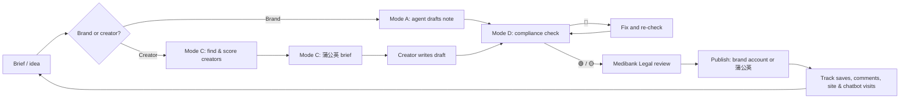

# Medibank 小红书 Agent

**An AI agent that helps Medibank run its China-facing Xiaohongshu (小红书 / RED) presence
for international students: brand-owned notes, creator (博主) collaborations, and a
compliance gate in front of both.**

Built by UNSW CDEV3000 MB Group 6 (T3 2026) as the project deliverable for Medibank.

> ⚠️ The compliance rules in this repo are a student research summary, not legal advice.
> Medibank Legal & Compliance and PRC counsel should review `skills/medibank-xhs/references/compliance.md`
> before the agent is used for real campaigns.

---

## The problem it solves

Medibank's OSHC features are good, but students don't discover them. Most Chinese
students let an education agent arrange their OSHC and never look at the policy, so they
don't know what they're covered for, how to claim, or that a 24/7 support line exists.

小红书 is where these students research studying in Australia. But it is a mainland
Chinese platform, and Medibank has no insurance licence in China, so it cannot *sell*
there. The agent is built around that line:

> **On 小红书, Medibank informs and helps. It does not sell.**

## The campaign it runs: 看懂自己的保险 (Know your own cover)

```
小红书 note (creator or brand)  →  student opens their own offer letter / CoE
   →  university OSHC page (e.g. UNSW: preferred provider is Medibank)
   →  Medibank university OSHC site + student chatbot  →  Medibank app & support line
```

Content never contains prices, links, QR codes or "DM me to buy". It gives students the
habit of checking their own cover, and names the next step in words.

## What the agent does

| Mode | Ask it… | You get |
|------|---------|---------|
| **A 写笔记** Brand note | "写一篇：第一次在悉尼看 GP 怎么做" | Note body, cover lines, titles, hashtags, image plan, compliance verdict, facts Medibank must confirm |
| **B 内容规划** Content plan | "2027 T1 开学季 4 周内容计划" | Calendar (brand vs creator, pillar, format, metric) tied to the student journey |
| **C 博主合作** Creators | "找 UNSW 新生相关的博主" / "写一份蒲公英 brief" / "审这篇博主稿" | Search plan, scored shortlist, vetting verdict, brief, draft review |
| **D 审稿** Compliance check | Paste any draft | 🟢 / 🟡 / 🔴 verdict, each problem line with rule ID and fixed wording |

Every piece of publishable text goes through two checks: a keyword scanner
(`scripts/compliance_scan.py`, 19 rule groups) and the model reading it against the full
rulebook (meaning, not only words).

---

## How Medibank uses it

There are three ways in, and they share one set of skill files. Pick the one that matches your team's tools.

### Option 1: Claude.ai Project (no code, recommended for the social team)

1. In Claude.ai, create a **Project** called "Medibank 小红书".
2. Upload every file in `skills/medibank-xhs/references/` to the project knowledge.
3. Paste the contents of `skills/medibank-xhs/SKILL.md` into the project instructions.
4. Chat: "写一篇小红书：offer letter 里 OSHC 那一栏怎么看". Paste creator drafts to
   check them.

*(Claude.ai can't run the Python scanner in this setup; the model applies the same rules
by hand. Use Option 3 for the scanner and the creator scoring.)*

### Option 2: Claude Code or OpenAI Codex (for the digital team)

The skill follows the open Agent Skills format (`SKILL.md` + `references/` + `scripts/`),
so the same files work in both tools. The repo already ships a copy where each tool looks:

| Tool | Skill folder in this repo | Also reads |
|------|---------------------------|-----------|
| Claude Code | `.claude/skills/medibank-xhs/` | `CLAUDE.md` |
| OpenAI Codex (CLI, IDE, app) | `.agents/skills/medibank-xhs/` | `AGENTS.md` |

```bash
git clone <this repo>
cd medibank-xhs-agent
claude        # Claude Code: the skill loads when your request matches
codex         # Codex: same; or type $medibank-xhs (or /skills) to call it directly
```

Then just ask: "帮我审一下这篇博主稿" or "给这批博主打分 examples/kol_candidates.csv".
Both tools run the scanner and scorer themselves.

To use the skill outside this folder, copy `skills/medibank-xhs` to
`~/.claude/skills/` (Claude Code) or `~/.agents/skills/` (Codex).

### Option 3: Command line (any team with an Anthropic API key)

```bash
pip install -r requirements.txt
export ANTHROPIC_API_KEY=...        # from console.anthropic.com

python -m xhs_agent post  "写一篇：落地后怎么激活 OSHC 和下载 app"
python -m xhs_agent plan  "2027 年 T1 开学季，4 周，UNSW 新生"
python -m xhs_agent brief "腰部博主，悉尼在读研究生，图文，主题：看懂自己的保险"
python -m xhs_agent review creator_draft.txt
python -m xhs_agent check  my_draft.txt
python -m xhs_agent chat

# Offline, no API key needed:
python -m xhs_agent scan examples/draft_bad.txt
python -m xhs_agent kol  examples/kol_candidates.csv --out scored.csv
```

The runner uses Claude Opus 5.5 with server-side refusal fallback and prompt caching
(the whole rulebook is cached, so repeat requests are cheap).

---

## Day-to-day workflow



Details and a weekly rhythm: [`docs/workflow.md`](docs/workflow.md).

### Finding creators

The agent can't see live 小红书 data, so it never invents creator names. Instead:

1. It writes the search plan (keywords, 蒲公英 filters, tiers, red flags).
2. Your team exports candidates from 蒲公英 or 千瓜 into the columns of
   [`examples/kol_candidates.csv`](examples/kol_candidates.csv).
3. `kol` scores them out of 100 (audience fit 30, engagement 25, relevance 20,
   trust 15, cost 10) with hard stops for agency/insurance sellers, competitor deals in
   the last 90 days, undisclosed ads and fake fans.

```
 #  creator            tier   score  band
 1  示例_悉尼读研日记    KOC     95.0  go
 2  示例_澳洲留学全攻略  头部     94.5  go
 ...
 6  示例_留学规划师Amy   腰部      0.0  no   Sells agency or insurance services
```

---

## What it will not do

* Write prices, discounts, quotes, competitor comparisons, purchase links or "DM to buy".
* Collect students' personal information through 小红书.
* Pay or brief creators outside 蒲公英, or let paid notes pass as "无广".
* Criticise education agents (they are a legitimate channel; the message is "know your
  own cover", not "agents are bad").
* Give visa or medical advice.
* Replace Legal review. 🟢 means "passes the agent's checks", not "legally cleared".

## Repository map

```
skills/medibank-xhs/          the source copy: edit here, then run sync_skills.py
  SKILL.md                    the agent: modes, workflow, hard limits
  references/
    compliance.md             PRC, 小红书 and Australian rules with sources (CN-1…AU-7)
    brand-facts.md            the only Medibank facts the agent may use
    student-strategy.md       campaign, funnel, segments, calendar, metrics
    kol-playbook.md           creator tiers, search, scoring, brief template, review
    content-playbook.md       pillars, brand voice, note and video templates
    style-checks.md           punctuation, AI-flavour, absolute terms, titles
  scripts/
    compliance_scan.py        keyword scanner (exit 0 green / 1 amber / 2 red)
    rules.json                editable rule list
    kol_score.py              creator scoring
.claude/skills/medibank-xhs/   synced copy for Claude Code
.agents/skills/medibank-xhs/   synced copy for OpenAI Codex
AGENTS.md / CLAUDE.md          project instructions each tool reads
sync_skills.py                 refreshes both copies from skills/
xhs_agent/                    command-line runner (Claude API)
examples/                     sample drafts, sample creator CSV, sample outputs
docs/workflow.md              team workflow and roles
tests/                        pytest: scanner, scorer, copies in sync
```

## Keeping it up to date

* **After any edit:** change files only in `skills/medibank-xhs/`, then run `python sync_skills.py`.
* **Every intake:** Medibank updates `brand-facts.md` (benefits, trials, offers change).
* **When a note gets throttled or rejected:** add the words to `rules.json` with the date.
* **When the law or 小红书 rules change:** update `compliance.md`; items marked **[VERIFY]**
  are the first ones to confirm.

## Credits

* Writing flow, style checks and title rules adapted from
  [aislinn-yang/rednote-writing-skill](https://github.com/aislinn-yang/rednote-writing-skill) (MIT).
* Creator tiers and vetting ideas informed by
  [vivy-yi/xiaohongshu-skills](https://github.com/vivy-yi/xiaohongshu-skills) (concepts only; no code or text copied).
* See [`NOTICE.md`](NOTICE.md).

---

## 中文简介

这是给 Medibank 用的小红书 agent，帮团队管理面向中国留学生的小红书内容，包括**品牌自营笔记**和**博主合作笔记**，所有内容发布前都过同一道合规检查。

核心原则：在小红书上，Medibank **只做科普和服务说明，不做销售**（不报价、不比价、不放链接、不私信卖保险）。

主推内容方向是“看懂自己的保险”：提醒同学们中介可以帮你办保险，但保了什么、怎么用，要自己看懂。引导路径是：自己看 offer letter → 学校 OSHC 页面 → Medibank 学校专属 OSHC 网站和 chatbot。

三种用法：Claude.ai Project（不用写代码）、Claude Code 或 OpenAI Codex（同一套 skill 文件，两边都能用）、命令行工具。具体步骤见上面的 “How Medibank uses it”。
